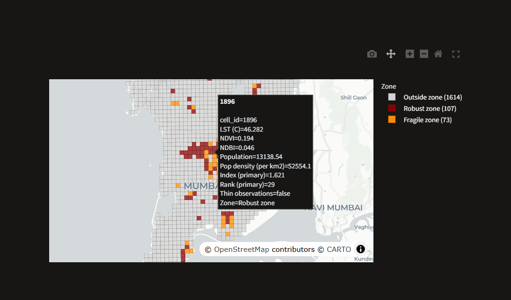
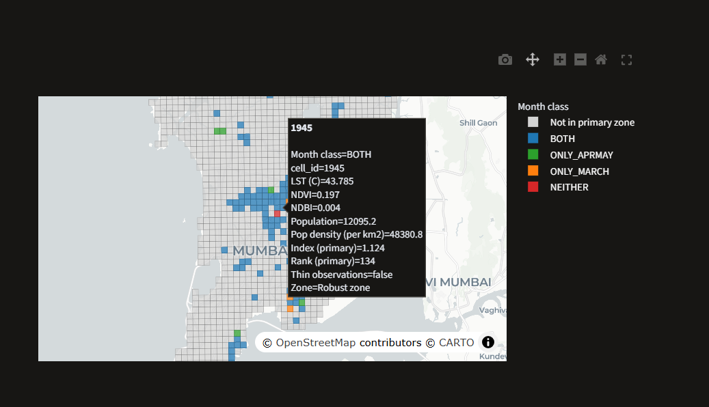

# Mumbai Urban Heat Hazard and Exposure Map

An interactive map of land surface heat hazard and population exposure for Greater Mumbai (BMC), on a 500 m grid. Built as a portfolio project.

**This is a hazard and exposure map, not a vulnerability map.** It has no social, income or health data. The "S" component is land cover only.

## What it shows

- **Zone map:** the top 180 cells (about 10 percent of 1794 core cells) by a combined heat index. 107 cells are **robust** (in the zone under all five exposure weight schemes tested) and 73 are **fragile** (in the zone under only some).
- **Index map:** the continuous index, with a toggle between the primary index and a no-exposure version.
- **Month view:** whether each zone cell appears in the March composite zone, the April-May composite zone, both, or neither.
- **Cell detail:** every stored property for one cell.




## Data

| Layer | Source | Notes |
|---|---|---|
| Land surface temperature (LST) | Landsat 8/9, March to May 2024 to 2026 | 24 effective dates, March heavy. Thermal band is natively 100 m. |
| NDVI, NDBI | Landsat 8/9 | Used for the land cover component S. |
| Population | WorldPop 2020 | About 5 percent above the MCGM 2023 figure. |
| Boundary | Ward file | About 10 years old. |

Grid: 84 x 48 = 4032 cells in EPSG:32643. 2005 cells intersect BMC and 1794 are "core" cells (the analysis population). The app file uses lon/lat (CRS84).

## Method in brief

- H = standardised LST. S = standardised (minus NDVI plus NDBI). E = standardised population density on land.
- Primary index = 0.4 H + 0.4 S + 0.2 E. Matched no-exposure index = 0.5 H + 0.5 S.
- The zone is the top 180 cells by the primary index.
- The exposure weight of 0.2 is a **judgment call**, not an estimated quantity.

## Findings, and how far they go

- **Exposure weight matters.** 107 cells stay in the zone at all five weight schemes and 73 do not. The zone with no exposure and the zone with 50 percent exposure overlap only weakly (Jaccard 0.423).
- **The index is mostly one axis.** H and S correlate at 0.825, so the index is largely one heat and built-up axis.
- **Month check.** March cell LST is about 2.14 C cooler than April-May. With S and E held at all-date values, hotspot zones from March and April-May composites overlap at Jaccard 0.80, and 106 of the 107 weight-robust cells appear in both. This does not say anything about S or E stability across months, or about seasons outside March to May.
- **Clusters segment a continuum.** K-Means clusters split a continuous gradient. They are not discovered classes.

## Limitations

- LST is **surface** temperature, not air temperature, and not what a person feels.
- The composite uses few clear days and is March heavy. April-May is about 2.1 C warmer than March.
- Landsat thermal data is natively 100 m. Cells are 500 m.
- Zones are a top-10-percent threshold, not a natural class. Weights are judgment calls.
- `thin_obs` cells have fewer clear observations. They cluster in one eastern band and are not over-represented in the zone (8 of 180).
- The app shows rounded values. Zone flags come from full precision data and are never recomputed from rounded values.
- Sanity checks against a park area and the coastline were consistent, but the park box coordinates are approximate and unverified.
- There is no automated test for the app itself. The 62 tests cover the data pipeline utilities. The app was checked by hand.
- Most logs are gitignored (15 are tracked) and are not shipped evidence.
- `src/month_index_r2.py` was edited after it produced `cells_index_month.csv`, so that file's provenance rests on the independent recompute in `src/verify_month_csv_r3.py`.
- The BMC boundary used here covers 458.1 km2, about 5 percent below the 483.14 km2 on the MCGM site. The cause has not been checked.
- The 0.80 overlap between the March and April-May zones and the 106 of 107 figure come from `logs/phase7b_month_index.txt` and `logs/phase7c_verify_r3.txt`, which are not in the repository. STATUS.md also shows a Jaccard of 0.644 between the March and April-May zones. That figure is for LST alone, not for the full index.

## Data sources and licence

- Landsat 8/9 imagery courtesy of the U.S. Geological Survey. Landsat data are in the public domain.
- Population: WorldPop (School of Geography and Environmental Science, University of Southampton, www.worldpop.org), licensed CC BY 4.0 (Bondarenko, Kerr, Sorichetta and Tatem 2020, India constrained 100 m, doi 10.5258/SOTON/WP00684). The values were aggregated to the 500 m grid, so the per-cell population in this repository is a derived product.
- Basemap tiles: OpenStreetMap contributors and CARTO.
- Ward boundary: BMC ward polygons, recorded in PLAN.md as coming from the DataMeet Municipal Spatial Data collection (https://projects.datameet.org/Municipal_Spatial_Data/). The boundary file itself is not in this repository. Licence statements for that collection are not consistent across sources, so check them before reusing the file.
- No open source licence has been added to the code or the derived data, so the default copyright rules apply.

## Run it

```
conda env create -f environment.yml
conda activate uhi
pip install -r requirements.txt
streamlit run app.py
```

`environment.yml` pins only Python 3.11. `requirements.txt` pins four packages (streamlit, plotly, pandas, numpy), not the whole environment. geopandas, shapely, rasterio and pyarrow are not pinned. Running `pip install -r requirements.txt` after the conda step replaces pandas 3.1.1 with 3.1.0.

If `conda activate uhi` tells you to run `conda init` (seen in a fresh Linux Codespace), initialise your shell first, for example `eval "$(conda shell.bash hook)"` in bash.

Creating the environment peaked at about 4.2 GiB of memory for the conda process (measured once, on one machine). It was killed three times on a 2 core, 8 GB Linux machine and finished on 4 cores, 16 GB. The cause was not isolated.

**Tested:**

- Linux x86_64, 4 cores, 16 GB, OpenBLAS: the environment builds, 62 tests pass, and all four app views render.
- Windows, hand-built environment: 62 tests pass.
- Windows, environment built from `environment.yml`: pytest crashed with a native numpy error during the 28th test, and the Cell detail view failed on a blocked pyarrow DLL on the author's PC. The cause is unresolved.

Combinations other than these are not tested.

The app reads `data/app/cells_app_r2.geojson` (about 1.4 MB, 1794 features, 30 properties each), which is committed. The basemap tiles load from the internet.

Tests: `python -m pytest tests -q`

The pipeline scripts are in `src/`. A step-by-step guide to regenerate the data from raw Landsat is not written yet.

## Status

Complete as a portfolio project. Open items are the unresolved Windows failure described under "Run it", the unverified licence of the ward boundary collection, and the missing guide for regenerating the data from raw Landsat. The code was written with an AI coding agent (OpenCode) in small rounds, under the rules in AGENTS.md. PLAN.md and FEASIBILITY.md are historical records and are not kept in sync with the final results.